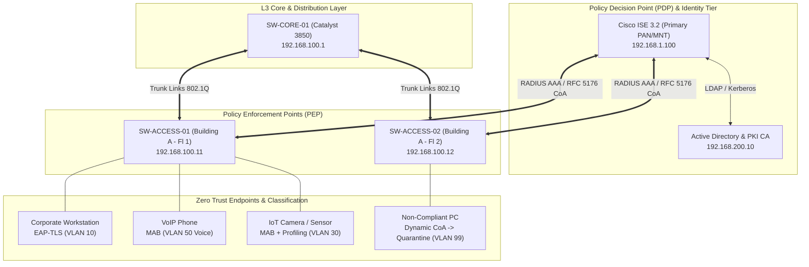

# 🔐 Zero Trust Network Access Control with Cisco ISE & 802.1X

[](LICENSE)
[](https://github.com/ghost-1705/zero-trust-cisco-ise/actions)


---

## 📖 Overview

This repository is an enterprise-grade reference architecture and practical implementation of **Zero Trust Network Access Control (ZTNA)** using **Cisco Identity Services Engine (ISE 3.2)**, **IEEE 802.1X / EAP-TLS**, and **Python/Ansible automation**.

Rooted in the **NIST SP 800-207** Zero Trust Architecture guidelines, this project demonstrates moving from an outdated perimeter security model to a strict **"Never Trust, Always Verify"** posture:
- **Policy Decision Point (PDP)**: Cisco ISE cluster evaluates client identity, Active Directory group memberships, PKI certificates, and real-time device health.
- **Policy Enforcement Points (PEP)**: Cisco Catalyst switches dynamically restrict traffic at the port level using Dynamic VLANs, Downloadable ACLs (dACLs), and RFC 5176 Change of Authorization (CoA).



---

## ✨ Key Architectural Highlights

| Pillar | Implementation | Zero Trust Control |
|---|---|---|
| 🔑 **Identity & PKI** | EAP-TLS (RFC 5216) & PEAP-MSCHAPv2 | Certificate-based mutual authentication via Enterprise CA |
| 🏷️ **Device Profiling** | Cisco ISE Profiler & MAB Fallback | Automatic fingerprinting for headless devices (printers, cameras, phones) |
| 🩺 **Endpoint Posture** | Cisco Secure Client (AnyConnect) Posture | Validates anti-virus definitions, OS patch levels, disk encryption |
| 🔒 **Micro-segmentation** | Dynamic VLANs & Downloadable ACLs (dACL) | Explicit per-session least-privilege network filters pushed from ISE |
| ↩️ **Dynamic CoA** | RFC 5176 Change of Authorization | Mid-session quarantine enforcement without physical port disconnection |
| 🤖 **Automation & CI** | Python (Netmiko, Requests) & Ansible | Automated switch configuration rollout, compliance audits, and CSV reporting |
| 🧪 **Zero-Setup Testing** | Mock Simulator & Automated Unit Tests | Fully testable without requiring access to a physical lab |

---

## ⚡ Zero-Setup Interactive Simulator

You don't need a multi-server Cisco ISE deployment to test and explore this repository! We provide an offline interactive simulator engine that emulates the entire Zero Trust lifecycle:

```bash
# Clone the repository
git clone https://github.com/ghost-1705/zero-trust-cisco-ise.git
cd zero-trust-cisco-ise

# Run the simulation engine
python3 scripts/python/ise_mock_demo.py
```

### Simulator Demo Output:
```
================================================================================
          ZERO TRUST NETWORK ACCESS CONTROL (ZTNA) SIMULATOR
          Cisco ISE 3.2 + IEEE 802.1X + Dynamic CoA Engine
================================================================================

[Step 1] Continuous Profiling & Active RADIUS Session Audit
---------------------------------------------------------------------------
Interface        MAC Address          Method   VLAN   Posture                    Status
========================================================================================
GigabitEthernet0/1 00:1A:2B:3C:4D:5E    dot1x    10     Compliant                  Authorized
GigabitEthernet0/2 00:2B:3C:4D:5E:6F    dot1x    10     Non-Compliant (AV Disabled) Authorized
GigabitEthernet0/3 00:50:60:03:00:01    mab      50     Not Applicable             Authorized
GigabitEthernet0/4 00:0C:29:A1:B2:C3    mab      30     Not Applicable             Authorized

[Step 2] Continuous Posture Evaluation via Cisco ISE AnyConnect Agent
---------------------------------------------------------------------------
[*] Querying ISE MnT API for Endpoint: 00:2B:3C:4D:5E:6F
    - Anti-Virus Check : [FAIL] CrowdStrike Falcon sensor disabled
    - OS Patch Check   : [WARN] Missing KB5034441 security rollup
    - Evaluation Result: NON-COMPLIANT
[!] Zero Trust Policy Trigger: RFC 5176 Change of Authorization (CoA) required.

[Step 3] Executing RFC 5176 CoA Re-Authorization & DACL Enforcement
---------------------------------------------------------------------------
[*] Dispatching CoA-Request from ISE PAN to SW-ACCESS-01...
    >> RADIUS Code: 43 (CoA-Request) | ID: 104
    >> Cisco-AVPair: subscriber:command=reauthenticate
    >> Cisco-AVPair: dacl:in=DACL-QUARANTINE-REMEDIATION
[*] Response from SW-ACCESS-01: CoA-ACK (Code 44) Received.
[+] Session dynamically transitioned to VLAN 99 (Quarantine / Remediation).
```

---

## 🔄 Protocol Sequence & Control Flow

### 1. 802.1X EAP-TLS Authentication Flow
```mermaid
sequenceDiagram
    autonumber
    actor Supplicant as Endpoint (PC)
    participant Switch as Switch (Authenticator)
    participant ISE as Cisco ISE (Auth Server)
    participant AD as Active Directory / CA

    Supplicant->>Switch: EAPOL-Start
    Switch->>Supplicant: EAP-Request / Identity
    Supplicant->>Switch: EAP-Response / Identity (User UPN)
    Switch->>ISE: RADIUS Access-Request (Identity)
    ISE->>Switch: RADIUS Access-Challenge (EAP-TLS Start)
    Switch->>Supplicant: EAP-Request / EAP-TLS Start
    Supplicant->>Switch: EAP-Response / Client-Hello + Cert
    Switch->>ISE: RADIUS Access-Request (TLS Handshake)
    ISE->>AD: Validate Certificate Revocation (CRL/OCSP)
    AD-->>ISE: Certificate Valid & Group Confirmed
    ISE->>Switch: RADIUS Access-Accept (VLAN 10 + dACL)
    Switch->>Supplicant: EAP-Success
    Note over Switch,Supplicant: Port unblocked; Least-privilege dACL applied
```

### 2. Posture Failure & RFC 5176 Dynamic CoA Quarantine
```mermaid
sequenceDiagram
    autonumber
    actor Endpoint as Client (In-Session)
    participant Switch as Catalyst Switch
    participant ISE as Cisco ISE (PDP)

    Note over Endpoint,Switch: Active Employee Session (VLAN 10)
    Endpoint->>ISE: Health Report: Anti-Virus Disabled / Threat Detected
    ISE->>ISE: Match Authorization Rule: "Quarantine_NonCompliant"
    ISE->>Switch: RADIUS CoA-Request (Code 43) [subscriber:command=reauth]
    Switch->>ISE: RADIUS CoA-ACK (Code 44)
    Switch->>Switch: Apply Quarantine dACL + Move to VLAN 99
    Note over Endpoint,Switch: Client isolated; Allowed only to Remediation & Patch Servers
```

---

## 🔬 Wireshark Protocol Analysis (`captures/`)

Curated `.pcap` traces are included in [`captures/`](captures/) with a complete packet breakdown guide:

- **[`8021x_eap_tls_auth.pcap`](captures/8021x_eap_tls_auth.pcap)**: Complete EAPOL negotiation, TLS certificate exchange, and port authorization.
- **[`radius_cisco_ise_avpair.pcap`](captures/radius_cisco_ise_avpair.pcap)**: RADIUS Access-Request and Access-Accept frames with embedded Cisco Vendor-Specific Attributes (dACL, VLAN, Session-ID).
- **[`rfc5176_coa_quarantine.pcap`](captures/rfc5176_coa_quarantine.pcap)**: Dynamic Change of Authorization packet exchange (UDP port 3799) triggering immediate quarantine.

👉 *See [captures/README.md](captures/README.md) for frame-by-frame analysis and Wireshark filter cheat sheets.*

---

## 🛠️ Automation & Infrastructure as Code

### Ansible Switch Provisioning
Automate AAA, 802.1X multi-auth, dynamic authorization, and BPDU guard rollout across all access switches:

```bash
cd automation/ansible
ansible-playbook -i inventory.ini deploy_8021x.yml
```

### Python Network Auditor (`scripts/python/vlan_audit.py`)
Queries Catalyst switches via Netmiko, parses authentication sessions, detects policy anomalies, and generates audit reports:

```bash
cd scripts/python
python3 vlan_audit.py --switch 192.168.100.11
```

### Cisco ISE ERS REST Client (`scripts/python/ise_api_check.py`)
Performs programmatic quarantine, retrieves endpoint posture status, and tracks active sessions via ISE ERS & MnT APIs:

```bash
cd scripts/python
python3 ise_api_check.py --quarantine 00:1A:2B:3C:4D:5E
```

---

## 📁 Repository Structure

```
zero-trust-cisco-ise/
│
├── .github/
│   └── workflows/
│       └── ci.yml                     # Automated multi-version Python CI/CD pipeline
│
├── automation/
│   └── ansible/
│       ├── deploy_8021x.yml           # Enterprise 802.1X / CoA provisioning playbook
│       ├── inventory.ini              # Switch inventory & connection definitions
│       └── group_vars/all.yml         # RADIUS, VLAN, and timer variables
│
├── captures/
│   ├── README.md                      # Packet analysis & Wireshark filter guide
│   ├── 8021x_eap_tls_auth.pcap        # 802.1X EAP-TLS packet trace
│   ├── radius_cisco_ise_avpair.pcap   # RADIUS Access-Accept & Cisco AV-Pairs
│   └── rfc5176_coa_quarantine.pcap    # RFC 5176 Dynamic CoA packet trace
│
├── configs/
│   ├── switches/
│   │   ├── core-switch.cfg            # L3 Catalyst 3850 core (SVIs, OSPF, ACLs)
│   │   ├── access-switch-01.cfg       # Catalyst 2960-X with 802.1X & MAB
│   │   ├── access-switch-02.cfg       # Catalyst 2960-X with 802.1X & MAB
│   │   └── radius-test-commands.md    # CLI troubleshooting & verification commands
│   │
│   └── ise-policies/
│       ├── authentication-policy.md   # Policy Sets & identity store sequencing
│       ├── authorization-policy.md    # Rules, Authorization Profiles & CoA mapping
│       └── dacl-definitions.md        # Downloadable ACL rules (Employee, IoT, Quarantine)
│
├── topology/
│   └── network-topology.md            # Topology diagram, IP scheme, VLAN specifications
│
├── scripts/
│   ├── python/
│   │   ├── ise_mock_demo.py           # Offline interactive Zero Trust simulation engine
│   │   ├── ise_api_check.py           # Cisco ISE REST API client (ERS & MnT)
│   │   ├── vlan_audit.py              # Netmiko switch session audit to CSV
│   │   ├── generate_sample_pcaps.py   # Raw packet trace synthesizer
│   │   └── requirements.txt           # Python library dependencies
│   │
│   └── testing/
│       └── test-plan.md               # 12 formal test cases (802.1X, MAB, Posture, CoA)
│
├── tests/
│   ├── test_switch_configs.py         # Config syntax & security baseline unit tests
│   ├── test_vlan_audit.py             # Session parsing & regex unit tests
│   └── test_ise_api.py                # Mock API client unit tests
│
├── docs/
│   ├── setup-guide.md                 # Complete EVE-NG / GNS3 / ISE 3.2 lab build guide
│   └── zero-trust-concepts.md         # Zero Trust pillars & NIST SP 800-207 mapping
│
├── report/
│   └── project-report-template.md     # University & enterprise engineering report template
│
├── CONTRIBUTING.md                    # Community contribution guidelines
├── SECURITY.md                        # Security policy and disclosure
└── LICENSE                            # MIT License
```

---

## 🧪 Automated Unit Testing

All parsers, API payload generators, and switch configuration security baselines are covered by automated unit tests that run in CI:

```bash
# Run the complete test suite locally (zero external dependencies required)
python3 -m unittest discover tests -v
```

Output:
```
test_access_switch_01_aaa_baseline (test_switch_configs.TestSwitchConfigurations) ... ok
test_access_switch_01_dynamic_author_coa (test_switch_configs.TestSwitchConfigurations) ... ok
test_access_switch_01_port_security_controls (test_switch_configs.TestSwitchConfigurations) ... ok
test_core_switch_routing_and_dhcp (test_switch_configs.TestSwitchConfigurations) ... ok
test_ers_headers_defined (test_ise_api.TestIseApiClient) ... ok
test_get_all_endpoints (test_ise_api.TestIseApiClient) ... ok
test_get_endpoint_posture_compliant (test_ise_api.TestIseApiClient) ... ok
test_parse_auth_sessions (test_vlan_audit.TestVlanAuditParser) ... ok
test_parse_session_detail (test_vlan_audit.TestVlanAuditParser) ... ok

Ran 9 tests in 0.007s - OK
```

---

## 📄 License

This project is licensed under the **MIT License** — see the [LICENSE](LICENSE) file for details.

---

## 👤 Author & Maintainer

**Aswin (ghost-1705)**
- 📧 Contact: [aswincp1705@gmail.com](mailto:aswincp1705@gmail.com)
- 🔗 GitHub: [@ghost-1705](https://github.com/ghost-1705)
- 📂 Repository: [github.com/ghost-1705/zero-trust-cisco-ise](https://github.com/ghost-1705/zero-trust-cisco-ise)

### Acknowledgements
- Cisco Systems documentation, dCloud, and Cisco DevNet
- NIST SP 800-207 Zero Trust Architecture working group
- IEEE 802.1X standard working group
- EVE-NG and GNS3 network virtualization communities
